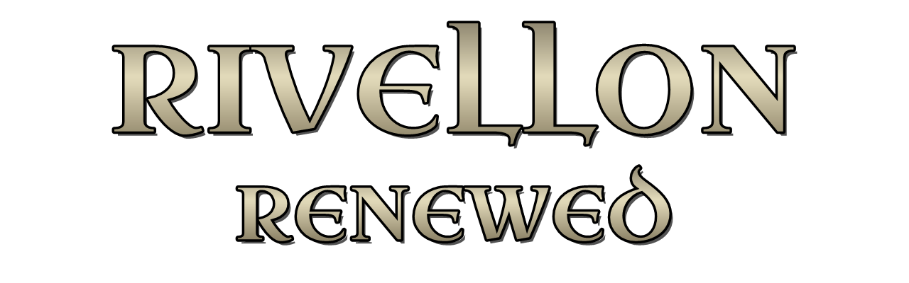

[](https://github.com/ermerp/rivellon-renewed/tags)
[](https://github.com/ermerp/rivellon-renewed/releases/latest)
[](https://github.com/ermerp/rivellon-renewed/commits/main)

# Rivellon Renewed

*A modernization mod that brings Divine Divinity to today's PCs and the Steam Deck* – unofficial, for the Steam/GOG version 1.0062A of the game (Larian Studios, 2002).

Rivellon Renewed is a plugin that loads with the game and changes it in memory only; no game file is modified. It draws the game's texts in sharp vector faces in the game's own look, starts the game in your monitor's resolution without a configuration tool, and fixes a few old annoyances. It works on Windows and on the Steam Deck, and every feature can be switched off in `RivellonRenewed.ini`.

## Features (v0.01)

- Game texts in vector faces in the game's own look: menu (Uncial Antiqua), diary title (Almendra SC), interface (Marcellus SC), books and letters (Fondamento, wider line pitch), dialog (DejaVu Sans Condensed Bold); the same pixels on Windows and Steam Deck.
- The game starts in the monitor's resolution, up to 1080 lines by default (1280×800 on the Steam Deck) – no configuration tool needed; `config.div` stays unchanged.
- Borderless full screen through dgVoodoo2 (Alt+Tab works), dgVoodoo watermark off.
- F10 and a lone Alt no longer freeze the game.
- Key repeat for Backspace, Delete, Left and Right in text fields.
- Smaller walk/run circle (225 px at every resolution) and double click to run.
- Ground fog on, kept in sync with the game's performance page.
- Optional: intro and story movies fill the screen (`[Display] FullScreenMovies=1`).
- A start banner "Rivellon Renewed v0.01 active" for a few seconds; frame-rate display on Ctrl+Shift+F2.

Each feature with its settings: [docs/features.md](docs/features.md). Changes per version: [CHANGELOG.md](CHANGELOG.md).

## Requirements

- Divine Divinity **1.0062A**, the version Steam sells (German, English and French tested). The GOG version should be the same build but is not tested yet.
- Windows 10/11, or a Steam Deck with Proton.
- The Russian Steam edition (1.0061) is supported on a best-effort basis: overlay and input work, the texts keep the game's original Cyrillic letters.

## Installation on Windows

1. Download `RivellonRenewed-<version>.zip` from [Releases](https://github.com/ermerp/rivellon-renewed/releases).
2. Open the game folder: in Steam right-click Divine Divinity → *Manage* → *Browse local files* (the folder with `div.exe`).
3. If there already is a `winmm.dll` in that folder (another mod), back it up – the zip contains its own `winmm.dll`.
4. Unpack the whole zip into the game folder.
5. Double-click `RivellonRenewed-Setup.cmd` and choose **1** (install dgVoodoo2). It downloads [dgVoodoo2](https://github.com/dege-diosg/dgVoodoo2) 2.87.5 from its official release, checks it (SHA-256) and puts its files into the game folder. Recommended: it gives the borderless full screen and sharp scaling. Without it the mod works too, with the game's own full screen.
6. Start the game as usual. The banner "Rivellon Renewed v0.01 active" in the top-left corner shows that the mod is loaded.

No administrator rights are needed. The mod sets dgVoodoo2's options (watermark off, borderless full screen, scaling) at every start; if `RivellonRenewed.log` says it cannot write `dgVoodoo.conf`, turn the watermark off yourself in `dgVoodooCpl.exe` (tab *DirectX*, *dgVoodoo Watermark*).

## Installation on the Steam Deck

1. Switch to Desktop Mode and download the zip from [Releases](https://github.com/ermerp/rivellon-renewed/releases).
2. Open the game folder: in Steam *Manage* → *Browse local files* (usually `~/.local/share/Steam/steamapps/common/divine_divinity`).
3. Unpack the whole zip into it. There is no setup to run on the Deck: `RivellonRenewed-Setup.cmd` is for Windows only (it installs dgVoodoo2, which the Deck does not need).
4. Still in Desktop Mode, copy this line from this page in the browser and paste it into the game's *Properties* → *Launch Options* (Ctrl+V):
   ```
   WINEDLLOVERRIDES="winmm=n,b" %command%
   ```
5. Switch back to Game Mode and start the game there. On the very first start after installing the game, Steam runs the configuration tool and then the game once **without** the mod (no banner) – quit it from the main menu; Steam then starts the game again by itself, now with the mod.

## Settings

All settings are in `RivellonRenewed.ini` in the game folder; each one is explained by a comment above it, and [docs/features.md](docs/features.md) says which settings belong to which feature. Every feature can be switched off on its own (`0` = off). Change the file while the game is not running.

## Uninstall

- **Windows:** double-click `RivellonRenewed-Setup.cmd` and choose **2**. It removes the mod, its loader (`winmm.dll`) and the dgVoodoo2 files it installed (nothing it did not put there); the game then runs as the original. Restore your backed-up `winmm.dll` if you had one.
- **Steam Deck:** delete `winmm.dll`, `RivellonRenewed.asi`, `RivellonRenewed.ini`, `RivellonRenewed.log`, `RivellonRenewed.prev.log`, `RivellonRenewed-Setup.cmd` and the folder `RivellonRenewed` from the game folder, and clear the launch options.

The mod never changes your savegames or `config.div`.

## Known issues

- After starting a new game the world can stay black with "Game paused" in a corner – click once into the game to continue.
- While the frame-rate display is on, it can appear in the preview picture of a save made at that time. The same goes for the start banner if you save within its first seconds.
- If the game crashes in full screen on Windows, turn off the full-screen optimizations for `div.exe` (right-click `div.exe` → *Properties* → *Compatibility*).
- With dgVoodoo2 the Steam overlay does not show.
- A Steam Machine is expected to work like the Steam Deck but is not tested.

## Reporting problems

Please open an [issue](https://github.com/ermerp/rivellon-renewed/issues) and attach the logs from the game folder: `RivellonRenewed.log` (the last start) and `RivellonRenewed.prev.log` (the one before); older starts are in `RivellonRenewed\logs\`. Say whether you play on Windows or the Deck and which language your game is in.

## Thanks

- **Larian Studios** for Divine Divinity.
- **ThirteenAG** for [Ultimate ASI Loader](https://github.com/ThirteenAG/Ultimate-ASI-Loader), which loads the mod.
- **Dege** for [dgVoodoo2](https://github.com/dege-diosg/dgVoodoo2).
- **Tsuda Kageyu** for [MinHook](https://github.com/TsudaKageyu/minhook) (with the Hacker Disassembler Engine by Vyacheslav Patkov) and **Sean Barrett** for [stb_truetype](https://github.com/nothings/stb).
- **Brian J. Bonislawsky** (Astigmatic) for Uncial Antiqua, Fondamento and Marcellus SC, **Ana Sanfelippo** for Almendra SC, and the **DejaVu fonts team**.
- **[Ry.Morrow](https://www.youtube.com/@ry.morrow)** and **[Magilla Grodd](https://www.youtube.com/@magillagrodd)** for their videos on Divine Divinity, which pointed us to problems worth fixing and to the game's patch history.
- For knowledge and leads: **atom0s**, **Raanar**, **usernameak**, the Steam community forum and the Divinity Wiki.

Everything we use from others, with links: [docs/credits.md](docs/credits.md).

## How this mod is made

Rivellon Renewed is developed with the help of an AI assistant, Claude Code (Anthropic). It does most of the reverse engineering of the game's EXE, writes most of the code and the documentation, and runs automated tests. A human decides what the mod does and how it looks, plays and tests every change on Windows and the Steam Deck, and approves every release. The game's code is never copied: findings are written down in our own words (`docs/re/`) and the mod is our own code.

## Building (developers)

Requirements: Visual Studio Build Tools 2022 (MSVC, x86), CMake ≥ 3.24.

```
cmake -S . -B build -G "Visual Studio 17 2022" -A Win32
cmake --build build --config Release
```

Output: `build/Release/RivellonRenewed.asi`. Configuring fetches [MinHook](https://github.com/TsudaKageyu/minhook) v1.3.4 and [stb_truetype](https://github.com/nothings/stb) v1.26 (pinned commits) via CMake `FetchContent`. Unit tests (no game needed): `ctest -C Release --test-dir build --output-on-failure`. Release zip: `tools/release/New-Release.ps1` ([docs/dev/workflow.md](docs/dev/workflow.md)).

What we learned about the game: [docs/how-the-game-works.md](docs/how-the-game-works.md), in detail in [docs/re/](docs/re/README.md). Why the mod is built the way it is: [docs/decisions.md](docs/decisions.md).

## Notice

Not affiliated with or endorsed by Larian Studios. Divine Divinity is a trademark of Larian Studios.

This project contains **no game files** and requires a legally purchased copy of Divine Divinity.

## License

Our own code is under the [MIT License](LICENSE); it does not cover the game, which belongs to Larian Studios. Bundled and downloaded third-party components (MinHook, stb_truetype, Ultimate ASI Loader, the fonts, dgVoodoo2) keep their own licenses: [THIRD-PARTY-NOTICES.md](THIRD-PARTY-NOTICES.md). The release zip carries the license texts in `RivellonRenewed\licenses\` and `RivellonRenewed\fonts\`.
